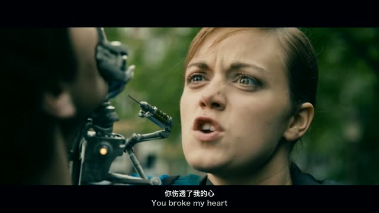
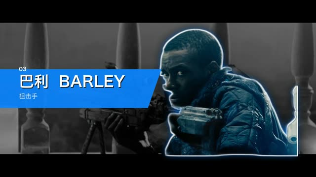
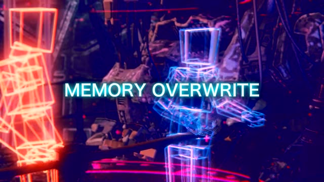
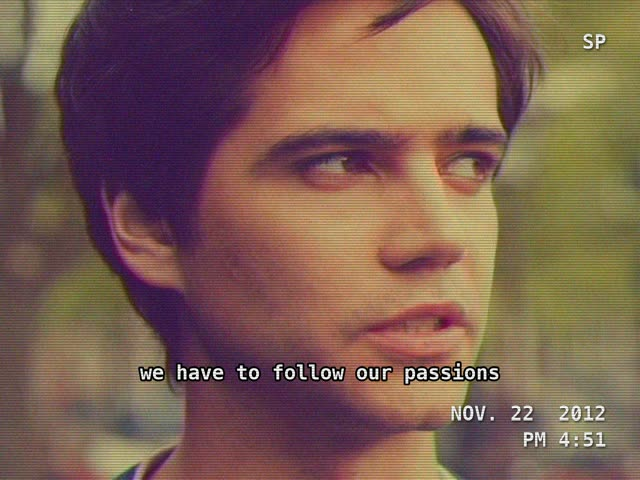
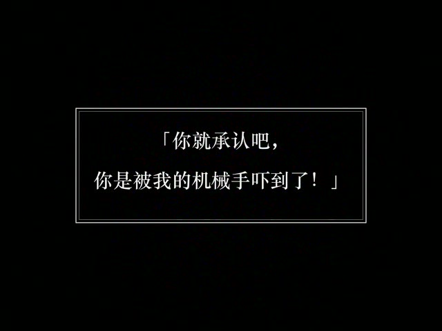
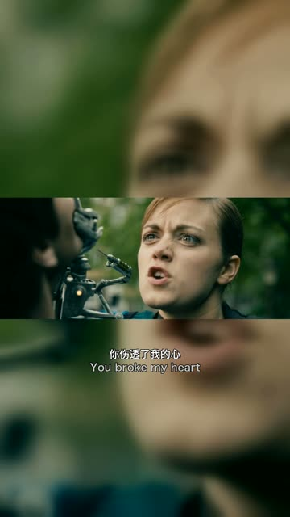
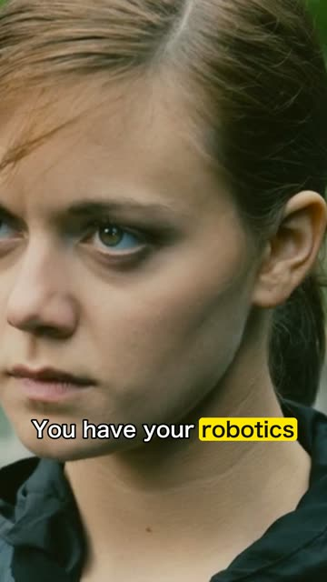
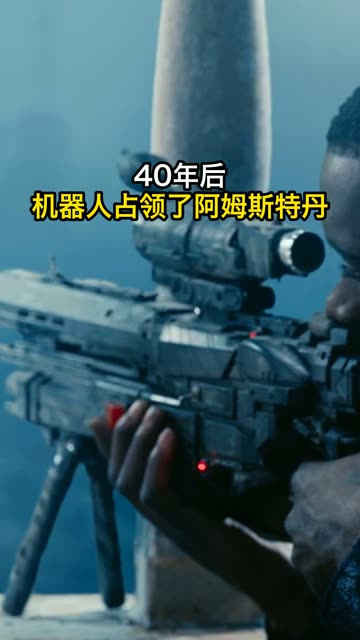

# cutvideo

A [Claude Code](https://claude.com/claude-code) skill that turns raw footage into a finished
video. You hand Claude the video files; it watches them (contact sheets + transcript), plans
the cut, renders it with ffmpeg, reviews its own render, and iterates.

It handles talking-head jump cuts, vlogs, highlight montages, beat-synced shorts (9:16),
trailers, cast intros, and product or event recaps, with subtitles, transitions, effects,
colour grading, titles and background music.

## Gallery

Eight edits of the open movie *Tears of Steel*, one style each, all made by Claude with this
skill from the film alone. Click a thumbnail to download the video; the edit plans and build
scripts are in [`examples/tears-of-steel/`](examples/tears-of-steel/).

<table>
<tr><td align="center"><a href="https://github.com/fujiezee/cutvideo/releases/download/showcase-v1/tos_trailer_16x9.mp4"></a><br><b>Trailer</b><br><sub>16:9 · 1:11</sub></td><td align="center"><a href="https://github.com/fujiezee/cutvideo/releases/download/showcase-v1/tos_cast_16x9.mp4"></a><br><b>Cast intros</b><br><sub>16:9 · 0:35</sub></td><td align="center"><a href="https://github.com/fujiezee/cutvideo/releases/download/showcase-v1/tos_cyberpunk_16x9.mp4"></a><br><b>Cyberpunk glitch</b><br><sub>16:9 · 0:41</sub></td></tr>
<tr><td align="center"><a href="https://github.com/fujiezee/cutvideo/releases/download/showcase-v1/tos_vhs_4x3.mp4"></a><br><b>Retro VHS</b><br><sub>4:3 · 0:39</sub></td><td align="center"><a href="https://github.com/fujiezee/cutvideo/releases/download/showcase-v1/tos_silent_4x3.mp4"></a><br><b>Silent film</b><br><sub>4:3 · 0:46</sub></td></tr>
<tr><td align="center"><a href="https://github.com/fujiezee/cutvideo/releases/download/showcase-v1/tos_trailer_9x16.mp4"></a><br><b>Trailer, vertical</b><br><sub>9:16 · 1:11</sub></td><td align="center"><a href="https://github.com/fujiezee/cutvideo/releases/download/showcase-v1/tos_karaoke_9x16.mp4"></a><br><b>Word-highlight captions</b><br><sub>9:16 · 0:26</sub></td><td align="center"><a href="https://github.com/fujiezee/cutvideo/releases/download/showcase-v1/tos_beatmix_9x16.mp4"></a><br><b>Beat-sync mix</b><br><sub>9:16 · 0:20</sub></td></tr>
</table>

<sub>*Tears of Steel* © Blender Foundation · [mango.blender.org](https://mango.blender.org) ·
[CC BY 3.0](https://creativecommons.org/licenses/by/3.0/)</sub>

## Requirements

- `ffmpeg` / `ffprobe`
- Python 3.10+ with `numpy`, `opencv-python`, `Pillow`
- `faster-whisper` for transcripts and subtitles (the model downloads on first use)
- Optional: `rembg` for cleaner person cut-outs in character intros (OpenCV GrabCut is used
  otherwise)

```bash
pip3 install --user numpy opencv-python Pillow faster-whisper
```

## Install

Use it in this repository, or copy the skill into another project or into your user skills:

```bash
cp -r .claude/skills/video-edit <your-project>/.claude/skills/   # one project
cp -r .claude/skills/video-edit ~/.claude/skills/                # all projects
```

## Usage

Open Claude Code in the project and give it footage:

```text
Edit trip/*.mp4 into a 30-second vertical highlight reel with music.mp3, beat-synced
```

Claude creates a job folder under `edits/<job>/`, then produces the video, an `.srt` when
there is speech, and the `edl.json` it rendered from. To make changes later, ask Claude: it
edits `edl.json` and renders again.

## How it works

| Step | Script | Output |
|---|---|---|
| Analyze | `scripts/analyze.py` | shot list with motion, sharpness, colour and loudness scores; silences; transcript with word timings; music BPM, beats and drops; labelled contact sheets |
| Draft (optional) | `scripts/draft_edl.py` | a first-pass EDL: `jumpcut` (speech only) or `montage` (best shots, beat-synced) |
| Render | `scripts/render.py` | the video: trim, speed, reframe, effects, grade, transitions, text and subtitle layer, music ducking, -14 LUFS loudness |
| Review | `scripts/preview.py` | frame sheets of the output for checking framing, text and pacing |

The scripts also run on their own:

```bash
S=.claude/skills/video-edit/scripts
python3 $S/analyze.py in.mp4 --out edits/demo/work --music song.mp3
python3 $S/draft_edl.py edits/demo/work/analysis.json --mode montage --format 9:16 --music song.mp3 --out edits/demo/edl.json
python3 $S/render.py edits/demo/edl.json --draft   # half resolution, fast
python3 $S/render.py edits/demo/edl.json           # final
```

## Features

- **Transitions:** about 40 xfade types (fade, dissolve, slides, wipes, circle, zoom, whip, ...)
- **Effects:** Ken Burns zoom, punch-in, shake, flash, glitch, freeze frame, reverse, speed
  change, black and white, blur, grain, vignette, ghost trails
- **Grades:** natural, vivid, cinematic, teal_orange, warm, cool, moody, vintage, film, bw,
  fade, bright, trailer, vhs, silent, cyberpunk, or a `.cube` LUT; per-shot colour matching
- **Text:** title, caption, highlight, lower third, label, tag, quote; fade, pop, slide and
  typewriter animations; per-word colour highlights; CJK fonts
- **Subtitles:** built from the transcript and kept in sync across cuts and speed changes;
  word-by-word (karaoke) highlighting; bilingual lines; exported as `.srt`
- **Character intros:** freeze frame, person cut out in colour, name and role panel slide in
- **Audio:** music beds with ducking under dialogue, J/L cuts, synthesised trailer SFX
  (boom, hit, whoosh, riser, ...), beat sync, cuts pinned to music hits, loudness and
  true-peak control
- **Planning:** a written edit plan (structure, music map, look, text) before any render
- **Framing:** face-tracking crops that pan with the subject, static face-centred or manual
  focus, blurred background fill, or letterbox; one edit exported to 16:9 / 9:16 / 1:1 / 4:5
- **Self-check:** after rendering, the output is re-transcribed to confirm every caption is
  still intelligible in the mix, plus loudness, true-peak and silence checks
- **Looks:** scan lines, projector flicker, intertitle cards, neon and camcorder-stamp text
- **3D and effects:** extruded 3D titles with perspective animation, text placed behind
  people (per-frame cut-outs), three.js light effects (particles, holograms, light streaks,
  neon grid) composited like a screen blend
- **Style menu:** scores what a film can be cut into (trailer, cast intros, silent film,
  cyberpunk, ...) with the shots that support each style

Text is drawn with Pillow, so ffmpeg builds without `drawtext` or `libass` work.

## Docs

- [`SKILL.md`](.claude/skills/video-edit/SKILL.md): the workflow Claude follows
- [`reference/edl.md`](.claude/skills/video-edit/reference/edl.md): EDL format
- [`reference/editing-playbook.md`](.claude/skills/video-edit/reference/editing-playbook.md):
  editing recipes by video type
